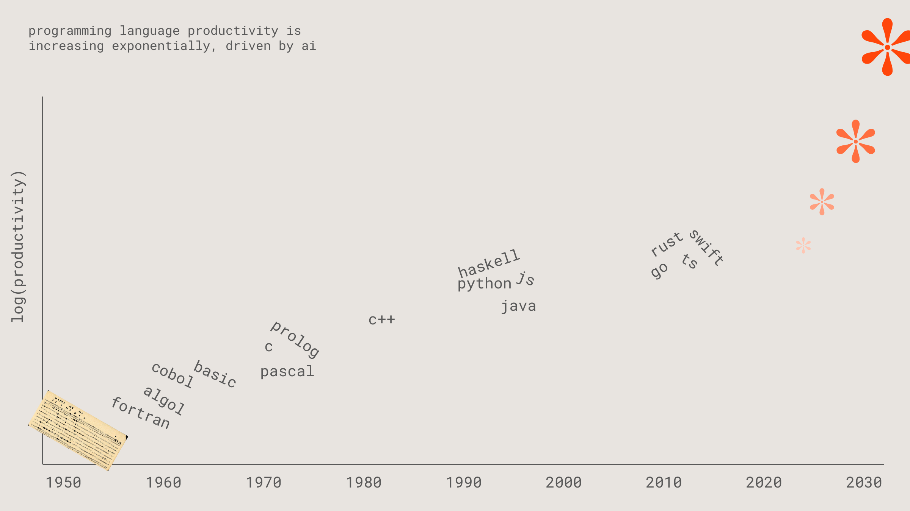
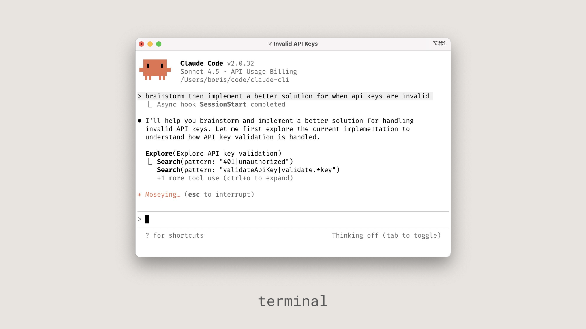
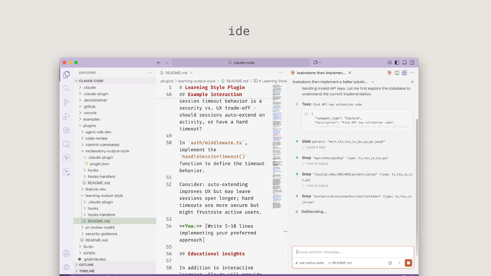
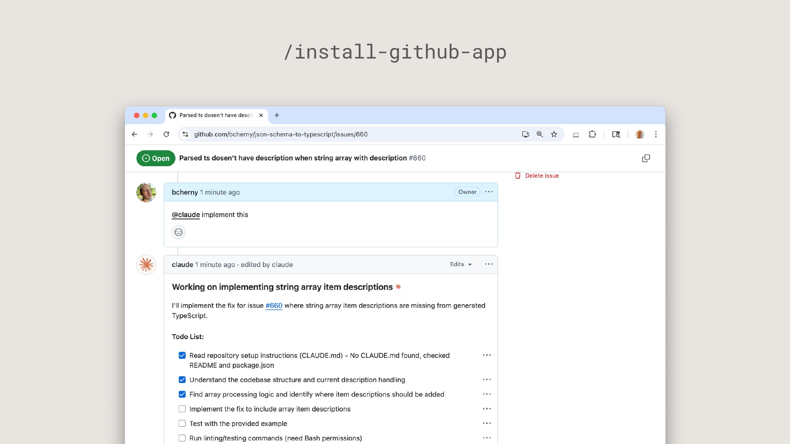

# Claude Code — Presentation

Source: [Claude Code - Presentation (1).pdf](../Claude%20Code%20-%20Presentation%20%281%29.pdf)

19 slides.

> Extraction note: Slide text is transcribed from the PDF text layer, with lists and tables reformatted for Markdown. The chart and UI screenshots are retained as slide images; redundant text-only slide images have been removed. Brief descriptions of image-only content are labeled as such; these are not additional speaker notes. Claims and product references are preserved as supplied, without updating them.

## Slide 1 · tl;dr

1. Programming is changing.
2. Build workflow with present models.
3. Plan six months out:
   - 30 times price reduction per year.
   - 3 times efficiency for training per year.
   - 3 times running efficiency per year.

## Slide 2 · 1 / programming is at an inflection point

## Slide 3 · Programming language productivity

Programming language productivity is increasing exponentially, driven by AI.

The chart plots `log(productivity)` against years from 1950 to 2030. It places programming languages along the historical curve, including Fortran, ALGOL, COBOL, BASIC, Pascal, C, Prolog, C++, Python, Haskell, Java, JavaScript, Go, Rust, TypeScript and Swift, followed by AI symbols. See the slide image for the chart.



## Slide 4 · IDE developer experience

IDE devx has evolved quickly, and will continue to change even more quickly.

## Slide 5 · Verification is evolving quickly, too

- Manual debugging
- Static types (ALGOL)
- Formal verification
- Abstract interpretation
- Automated testing
- Continuous integration
- Property-based testing (QuickCheck)
- Dependent typing
- E2E testing
- Chaos testing (Chaos Monkey)
- AI-powered vulnerability testing
- AI-powered unit testing (TestGen)
- AI-powered fuzz testing (Sapienz)
- Self play
- ...

## Slide 6 · Claude Code's approach: works everywhere

1. Terminal-native.
2. Low-level model access.
3. Infinitely hackable.

## Slide 7 · Works across the whole SDLC

| Understand | Plan | Build | Deploy | Maintain & Scale |
| --- | --- | --- | --- | --- |
| Explore codebase and history | Plan project | Implement code | Automate CI/CD | Debug errors |
| Search documentation | Develop tech specs | Write and execute tests | Configure environments | Large-scale refactor |
| Onboard & learn | Define architecture | Create commits and PRs | Manage deployments | Monitor usage & performance |

Using and mastering all of your team's CLI tools (e.g., git, docker, bq) so you can focus on solutions, not syntax.

## Slide 8 · Terminal

**Image description:** The slide shows a Claude Code terminal session investigating handling of invalid API keys. The screenshot is retained below.

Visible terminal text:

```text
Claude Code v2.0.32
Sonnet 4.5 · API Usage Billing
/Users/boris/code/claude-cli

> brainstorm then implement a better solution for when api keys are invalid
  Async hook SessionStart completed

I'll help you brainstorm and implement a better solution for handling
invalid API keys. Let me first explore the current implementation to
understand how API key validation is handled.

Explore(Explore API key validation)
  Search(pattern: "401|unauthorized")
  Search(pattern: "validateApiKey|validate.*key")
  +1 more tool use (ctrl+o to expand)

Moseying… (esc to interrupt)
? for shortcuts             Thinking off (tab to toggle)
```



## Slide 9 · IDE

**Image description:** The slide shows Claude Code alongside an editor, with repository files and a session in progress. The screenshot is retained below.

Principal visible editor and session text (some UI text is clipped):

```text
# Learning Style Plugin
## Example interaction

session timeout behavior is a
security vs. UX trade-off —
should sessions auto-extend on
activity, or have a hard
timeout?

In `auth/middleware.ts`,
implement the
`handleSessionTimeout()`
function to define the timeout
behavior.

Consider: auto-extending
improves UX but may leave
sessions open longer; hard
timeouts are more secure but
might frustrate active users.

**You:** [Write 5-10 lines
implementing your preferred
approach]

## Educational insights

Task: Find API key validation code
"subagent_type": "Explore"
"description": "Find API key validation code"
```

The repository explorer shows plugin folders, including `code-review`, `commit-commands`, `explanatory-output-style`, `learning-output-style`, `pr-review-toolkit` and `security-guidance`. The complete visible interface is retained in the slide image.



## Slide 10 · /install-github-app

**Image description:** The slide shows a GitHub issue requesting support for a description when storing array descriptions, followed by an `@claude implement this` comment and an implementation response. The screenshot is retained below.

Principal visible issue and response text:

```text
Parsed ts dosen't have description when string array with description #660

@claude implement this

Working on implementing string array item descriptions

I'll implement the fix for issue #660 where string array item descriptions
are missing from generated TypeScript.

Todo List:
- Read repository setup instructions (CLAUDE.md) — No CLAUDE.md found,
  checked README and package.json
- Understand the codebase structure and current description handling
- Find array processing logic and identify where item descriptions should be added
- Implement the fix to include array item descriptions
- Test with the provided example
- Run linting/testing commands (need Bash permissions)
```



## Slide 11 · SDK

```bash
claude -p \
  "what did i do this week?" \
  --allowedTools Bash(git log:*) \
  --output-format stream-json
```

Stack shown in the diagram:

1. Your app
2. Claude Code SDK
3. Anthropic, Bedrock, or Vertex API
4. Claude models

## Slide 12 · 4 / using Claude Code

## Slide 13 · Use cases

1. Codebase Q&A + research.
2. Write code:
   - 1-shot
   - Sidekick
   - Prototype
3. Integrate tools & MCPs.
4. Power automation.

## Slide 14 · 1. Ask Claude Code about your code

Example prompts:

> how do I make a new @app/services/ValidationTemplateFactory?

> why does recoverFromException take so many arguments? look through git history to answer

> why did we fix issue #18363 by adding the if/else in @src/login.ts api?

> in which version did we release the new @api/ext/PreHooks.php api?

> look at PR #9383, then carefully verify which app versions were impacted

> what did I ship last week?

## Slide 15 · 2. Teach Claude to use your tools

> use the barley cli to check for error logs

```bash
claude mcp add barley_server -- node myserver
```

> use the barley mcp server to check for error logs

## Slide 16 · 3. Fit the workflow to the task: explore and plan

**explore › plan › confirm › code › commit**

> figure out the root cause for issue #983, then propose a few fixes. Let me choose an approach before you code. ultrathink

## Slide 17 · 3. Fit the workflow to the task: tests first

**tests › commit › code › iterate › commit**

> write tests for @utils/markdown.ts to make sure links render properly (note the tests won’t pass yet, since links aren’t yet implemented). then commit. then update the code to make the tests pass.

## Slide 18 · 3. Fit the workflow to the task: visual iteration

**code › screenshot › iterate**

> implement [mock.png]. Then screenshot it with puppeteer and iterate till it looks like the mock.

## Slide 19 · 4. Use Claude Code to prototype
