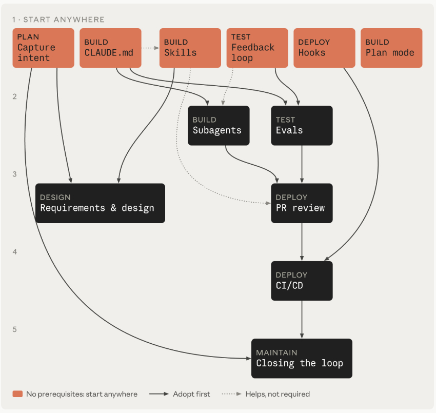
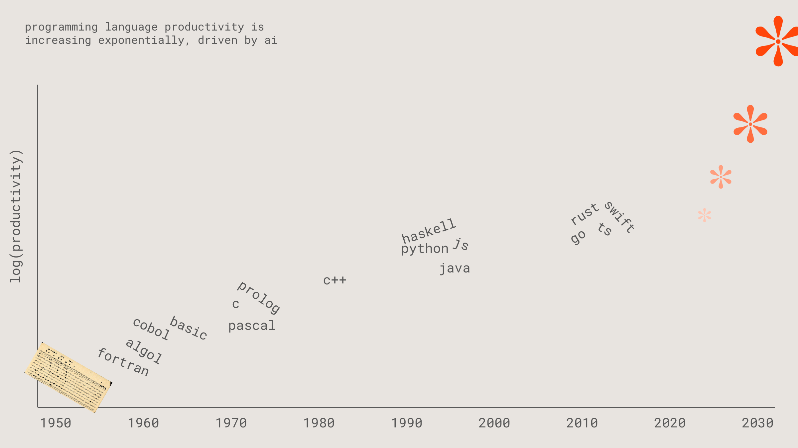
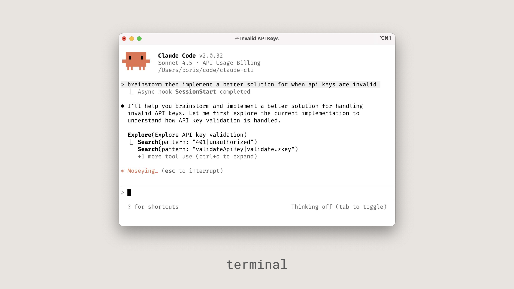
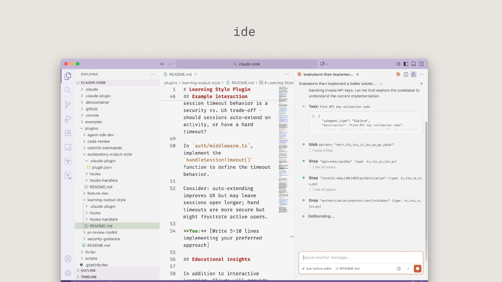
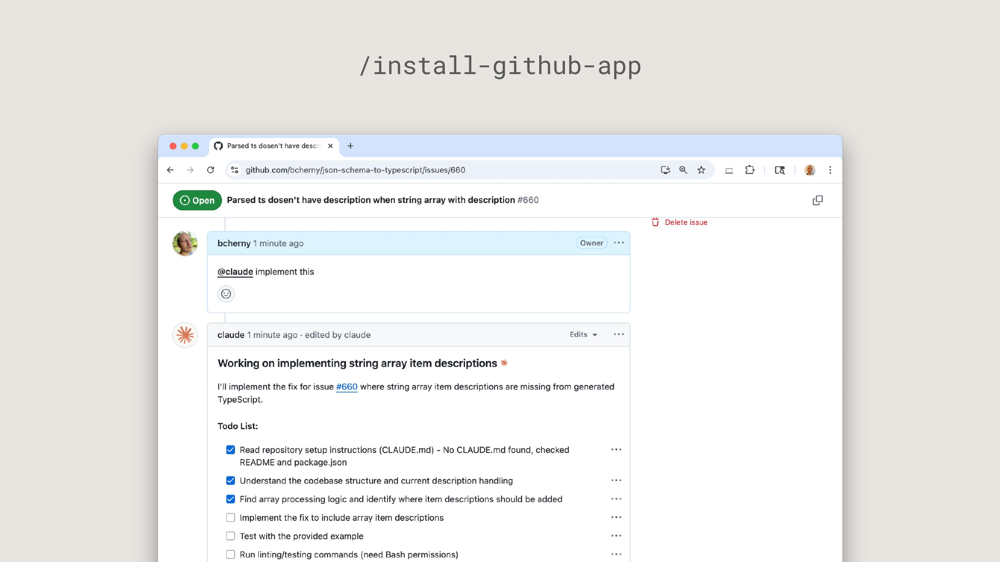

# AI for SDLC — All PDF content

Content extracted from all 14 supplied PDFs. See [the extraction index](README.md) for source coverage and extraction limits.

## Contents

1. [What changes and where to start](#document-01)
2. [Capture as intent.md](#document-02)
3. [Requirements and design](#document-03)
4. [Claude Code plan mode as the default starting point](#document-04)
5. [The CLAUDE.md](#document-05)
6. [Skills as institutional knowledge](#document-06)
7. [Parallel sessions and subagents](#document-07)
8. [Give Claude a feedback loop](#document-08)
9. [Continuous evals in CI](#document-09)
10. [AI in the PR review loop](#document-10)
11. [Hooks as approval gates](#document-11)
12. [CI/CD integration and deployment](#document-12)
13. [Closing the loop on metrics](#document-13)
14. [Claude Code — Presentation](#document-14)


---

<a id="document-01"></a>

## What changes and where to start

Source: [screencapture-academy-claude-courses-ai-native-sdlc-playbook-introduction-2026-10-27-15_42_38.pdf](../screencapture-academy-claude-courses-ai-native-sdlc-playbook-introduction-2026-10-27-15_42_38.pdf)

Claude Academy · The AI-native SDLC playbook · Lesson 1 · 3 min

> Extraction note: OCR transcription of the visible article. Site navigation and feedback controls are omitted. Code is transcribed as visible; source-clipped lines are incomplete, not reconstructed. The original PDF is linked above for reference.

Organizations have started using AI to write code at a speed unthinkable one year ago, yet the processes around the code haven't changed at the same pace.

The software development lifecycle (SDLC) is the process that takes software from idea to production. Most organizations run some version of the same six stages, covering planning, design, building, testing, deploying, and maintaining software.

### The shifts

The table below highlights the ends of the spectrum between traditional SDLC and AI-native SDLC, supported by Claude. Most organizations sit somewhere between the two columns.

| Stage | Traditional SDLC | AI-native SDLC |
| --- | --- | --- |
| Plan | Requirements gathered by committee, distilled through workshops and sign-offs, written up by hand | Claude synthesizes pain points straight from the sources and captures them within intent.md, which is human readable and machine actionable |
| Design | Spec written by analysts, parsed by designers | Requirements and design compressed into one working session with an agent, guided by standards encoded as skills, versioned in Git |
| Build | Tests and code are handwritten, and documentation is written after the main development happens | Tests and code are generated by AI, and institutional knowledge is maintained as versioned machine-readable CLAUDE.md files and skills |
| Test | QA gates at stage boundaries | Continuous evals woven through implementation |
| Deploy | Humans review every line of code, and governance occurs in review cycles, often inconsistently | Layers of agentic review with human review reserved for regulated and critical code. Governance is enforced as the AI acts, with hooks as approval gates |
| Maintain | Humans watch production for bugs | Agents monitor live deployments. Any breached control band is diagnosed and written back into the loop as a new intent.md |

Humans remain accountable for every decision that requires judgment.

### How the plays work

The plays are the core of the playbook and are grouped into six non-linear stages (Plan, Design, Build, Test, Deploy, Maintain), which together cover the complete lifecycle.

Each play covers:

- What changes

- Getting started

- Concrete steps for implementation

- Governance considerations

- How you measure whether it worked

Each play names its dependencies under "Prerequisites," which the dependency graph further illustrates.



The play dependency graph. Plays in the top row have no prerequisites; a solid arrow points to the plays that build on it, a dotted arrow means it helps but is not required.

### Pick your first play

The plays are modular, and organizations may choose to prioritize transforming different stages at different times based on their unique needs.

The six plays in the top row of the graph above have no prerequisites:

- Plan: Capture as intent.md

- Build: Claude Code plan mode as the default starting point

- Build: The CLAUDE.md

- Build: Skills as institutional knowledge

- Test: Give Claude a feedback loop

- Deploy: Hooks as approval gates


---

<a id="document-02"></a>

## Capture as intent.md

Source: [screencapture-academy-claude-courses-ai-native-sdlc-playbook-capture-intent-2026-10-27-15_42_49.pdf](../screencapture-academy-claude-courses-ai-native-sdlc-playbook-capture-intent-2026-10-27-15_42_49.pdf)

Claude Academy · The AI-native SDLC playbook · Lesson 2 · 4 min

> Extraction note: OCR transcription of the visible article. Site navigation and feedback controls are omitted. Code is transcribed as visible; source-clipped lines are incomplete, not reconstructed. The original PDF is linked above for reference.

The intent.md, which kicks off the software development process, can enter through different routes. A person has an idea, a ticket is filed, or an incident is surfaced via an alert (see Stage 6: Maintain).

When a person has an idea, they brainstorm with Claude and produce a Markdown proto-spec. In the traditional SDLC, the same person must then convince a member of the product team to write the idea up with them or on their behalf.

The proto-spec generated by Claude is human readable, version controlled, and immediately consumable by the next stage. The proto-spec is saved as an intent.md.

Regardless of whether the intent originates from an event trigger or a person, the same steps apply: the product owner reviews and corrects the agent-written intent.md before it is committed.

### What changes

| Traditional | AI-native |
| --- | --- |
| An idea passes through backlog entries, user stories, story points, and refinement meetings before anyone can act on it. Ownership transfers at each handoff, so what reaches engineering is several steps removed from what the originator meant. | The originator brainstorms with Claude and writes the result down as intent.md, a proto-spec in the originator's own terms. The artifact contains what is wanted, why, and under which constraints. Repeat processes are encoded via skills. |

### Getting started

- Prerequisites: None.

- Infrastructure: Claude access for people who are not engineers (claude.ai or Cowork); an agreed intent.md template; a shared, version-controlled home for intent that the product owner watches. For a single product the simplest home is an intent/ folder in the product repo. This setup keeps the artifact chain next to the code derived from it. A dedicated intent repo is only worth the overhead when intent spans many repositories, and in a monorepo it is a directory. The Legacy systems section in Stage 3: Build covers how this home relates to a Jira or requirements tool that already holds the record.

Setting this up is a one-time task for the platform or engineering team. A technical team member needs to stand up the intent home and decide who can write to it, since many contributors will come from across the organization.

Once the repository exists, contributors without Git experience don't need to use Git directly. Instead a connector to the version-control system (e.g., GitHub) lets Claude commit Markdown files on their behalf from claude.ai or Cowork.

### How to execute it

1. The originator describes the problem to Claude in their own words. The originator may describe what they cannot do today, who is affected by the idea, what better looks like, or what is out of scope. No formal language is required.

2. Brainstorm until the idea is concrete. Claude asks the questions an analyst would ask: scope, users, constraints, and what success looks like.

3. Ask Claude to write the result as intent.md using the organization's template, which can be encoded as a skill set up by a technical team member and signed off by a lead. This can cover the problem, proposed outcome, affected users and systems, constraints, and open questions.

4. The originator corrects anything Claude misunderstood.

5. Commit intent.md to the shared home. Author and timestamp join the record, and the product owner picks the idea up from there.

### What it looks like

intent.md :

```markdown

# Intent: claims status self-service

Author: J. Ortiz (claims operations). Status: draft.

## Problem

Customers phone the contact center to ask where their claim is.
Handlers spend roughly a third of call time on status-only queries.

## Proposed outcome

Customers see claim status, next step and expected date in the portal.

## Affected users and systems

Claims handlers, portal team, claims-core API.

## Constraints

No new PII in the portal session. Existing authentication only.

## Open questions

Do third-party loss adjusters need access too?
```

### Governance considerations

The evidence is the committed intent.md, which lists the author, the timestamp, and the full revision history. It's logged in the Git history of the intent home. The product owner approves, and the accept or reject decision that sends the intent into Stage 2: Design is recorded as the merge or the closing review.

### How to measure it

- Leading indicator: Time from first conversation to a committed intent.md, read from Git history on the intent home, which records author and timestamp. The expectation is for this to fall from a multi-week elicitation and refinement cycle to hours.

- Lagging indicator: The survival rate, or the share of intent.md files that the product owner accepts into Stage 2: Design rather than closes. The accept or reject decision is recorded as the merge of the artifact or the closed review. Additionally, count the changes to intent.md made after the first spec.md commit for the same change.


---

<a id="document-03"></a>

## Requirements and design

Source: [screencapture-academy-claude-courses-ai-native-sdlc-playbook-requirements-and-design-2026-10-27-15_42_56.pdf](../screencapture-academy-claude-courses-ai-native-sdlc-playbook-requirements-and-design-2026-10-27-15_42_56.pdf)

Claude Academy · The AI-native SDLC playbook · Lesson 3 · 5 min

> Extraction note: OCR transcription of the visible article. Site navigation and feedback controls are omitted. Code is transcribed as visible; source-clipped lines are incomplete, not reconstructed. The original PDF is linked above for reference.

Once the product owner approves the intent.md, Claude takes it and produces a requirements and design spec. This is guided by the organization's skills for brand, security, compliance, and UX.

The product owner reviews that spec, but doesn't write it. The goal of this process is to create a spec the engineering team can plan against, with flagged areas of concern.

Front-end work is the clearest example. Once the intent.md is accepted, the product owner mocks the design up in Claude Design from the intent.md, iterates on the mock, and then exports it to Claude Code to build.

### What changes

| Traditional | AI-native |
| --- | --- |
| Requirements and design are separate phases run by separate teams. Analysts formalize the idea into requirements, and designers then parse those back into a design. The separation exists for accountability, but it is slow and lossy. | Both phases happen in a single prompted session. Claude takes intent.md and produces a requirements and design spec, constrained by the organization's skills, with areas of concern flagged. |

### Getting started

- Prerequisites: Write an intent.md file, with brand, security, compliance, and UX policies written as skills.

- Infrastructure: A product owner with Claude access. No engineering skill is required.

### How to execute it

1. The product owner opens a session with the organization's skills available and attaches the intent.md.

2. The product owner's prompt points at the intent, names the constraints, and demands flagged concerns. Run it by hand at first, then codify it as an organization-level slash command. From there make the acceptance of intent.md in the intent home the trigger, with a non-interactive job that fires on the merge, runs the pass with the organization's skills loaded, and commits spec.md as a pull request (the CI/CD play in Stage 5: Deploy covers the plumbing). From that point the product owner's first involvement is the review.

3. The same product owner reviews the spec against the idea. Does the spec solve the stated problem, and are the open questions from intent.md answered or carried forward?

4. Work through the flagged concerns first as they are the points an analyst would have escalated. The product owner resolves each one with its policy owner before engineering sees the spec.

5. Commit spec.md alongside intent.md. The file pair records what was asked for and what was decided.

6. The product owner decides whether the spec and intent progress to build, consulting a technical lead for anything the organization classes as higher risk. A human teammate always makes this call, and accepting the spec is what starts the plan mode play in Stage 3: Build.

### What it looks like

The prompt:

Read the attached intent.md and produce a requirements and design spec for integrating it into our existing codebase. Apply the skills available to you so the plan conforms to our brand guidelines, security policies and UX standards. Document the spec fully as spec.md, ready to hand to the engineering team. Describe clearly any areas of concern, especially where you cannot satisfy contradicting policies.

The intent.md behind this example comes from an insurer that wants customers to see the status of a claim in its portal. In it, claims-api is the portal’s backend and claims-core is the older internal system that holds the claims. The prompt above turns it into this spec.md :

```markdown

# Spec: claims status self-service

From: intent.md (J. Ortiz, claims operations). Status: ready for product owner review.
Skills applied: secure-api-review, brand-voice, portal-ux.

## Requirements

- R1. A signed-in customer sees status, next step and expected date for each open claim.
- R2. Status is one of four states: received, in review, approved, paid.
- R3. The response carries those three fields and nothing else.
- R4. What the customer sees is at most 60 seconds old.

## Design

- New endpoint GET /claims/{id}/status in claims-api, behind the gateway JWT.
- claims-api reads the claim from claims-core. The portal never calls claims-core.
- New StatusPanel on the portal claims page. It caches each answer for 60 seconds.

## How each constraint in the intent is met

| Constraint | Met by |
| --- | --- |
| No new PII in the portal session | R3. None of the three fields is tagged pii in the schema. |
| Existing authentication only | The gateway JWT. No new login, token or role. |

## Open questions from the intent

- Do third-party loss adjusters need access too? Not answered. Carried forward as concern 1.

## Areas of concern

1. Loss adjusters have no portal account. Giving them access breaks "existing
   authentication only", so they are left out of this spec. Owner: security.
2. The portal-ux skill says every status shows a date. The brand-voice skill says
   never to state a payment date as a commitment. I cannot satisfy both as written.
   Proposed label: "Estimated date". Owner: compliance.
3. claims-core allows 50 requests a second. The 60-second cache should keep the
   portal under that, but nobody has load tested it. Owner: claims-core team.
```

The requirements are numbered so the plan and the review can cite them. Concern 2 sets two skills against each other, the kind of clash the prompt tells Claude to flag.

### Governance considerations

Instead of policy conflicts being discovered in a review weeks later, the live policy is read and applied while the spec is written. The organization's skills are applied as constraints on the spec. The spec, the prompt that produced it, and the skill versions in force are all logged in version control. The product owner signs off on the spec, and routes flagged concerns to the named policy owners.

### How to measure it

- Leading indicator: Elapsed time between the intent.md commit and the spec.md commit for the same change (two Git timestamps), compared with the old requirements-plus-design cycle.

- Lagging indicator: Requirements rework after build starts. Count spec.md commits dated after the first plan.md commit for the same change. Git log will give this directly.


---

<a id="document-04"></a>

## Claude Code plan mode as the default starting point

Source: [screencapture-academy-claude-courses-ai-native-sdlc-playbook-plan-mode-2026-10-27-15_43_06.pdf](../screencapture-academy-claude-courses-ai-native-sdlc-playbook-plan-mode-2026-10-27-15_43_06.pdf)

Original online lesson: [plan-mode](https://academy.claude.com/courses/ai-native-sdlc-playbook/plan-mode). Code blocks restored and checked against its HTML on 2026-10-27; clipped text was recovered from the source, not inferred.


Claude Academy · The AI-native SDLC playbook · Lesson 4 · 6 min

> Extraction note: OCR transcription of the visible article. Site navigation and feedback controls are omitted. Code examples cut off in the PDF were restored from the original online lesson linked below. The original PDF is linked above for reference.

Engineers start Claude Code sessions in plan mode, give Claude the approved spec.md from Stage 2: Design, and let it interview them, iterating on the plan until they are happy with it.

### What changes

| Traditional | AI-native |
| --- | --- |
| An engineer reads the design and starts writing code. How the change will be made, down to which files and which tests, stays in the engineer's head or at best in a ticket comment. Nobody else can review it. The first thing a reviewer sees is the finished diff, and by then rework is slow. | Work starts with a written plan that Claude produces in plan mode, where it can read the codebase without changing anything. The engineer corrects the plan before code is written, and the approved version is committed as plan.md for later stages to check against. |

### Getting started

- Prerequisites: The intent artifact (intent.md or spec.md ) if one exists, and the CLAUDE.md file helps.

- Infrastructure: Claude Code with access to the repository.

### How to execute it

1. The engineer starts the session in plan mode with Claude.

2. The engineer gives Claude the intent.md and the spec.md and asks for an implementation plan that names the files that change, the order of the work, and the tests that prove it.

3. Interrogate the plan by asking what the change could break, which step is most risky, and what other options Claude chose not to do.

4. Iterate until an engineer who has never seen the conversation could implement the change from the plan alone.

5. Commit the approved plan as plan.md. The plan joins the audit trail, and the PR review play (Stage 5: Deploy) checks the eventual diff against it.

6. Accept the plan and let Claude implement. With a solid plan, the implementation is often a single pass.

7. When implementation departs from the plan, update plan.md in the same commit. Consider using a hook to enforce synchronization between the two.

### What it looks like

The plan below is for a change at an insurer: a panel in the customer portal that shows the status of a claim. The panel calls the portal's backend, claims-api, which reads from claims-core, an older internal system.

plan.md :

```markdown
# Plan: claims status self-service (from intent.md and spec.md)

## Files that change

portal/src/claims/StatusPanel.tsx (new), claims-api/routes/status.py, claims-api/tests/test_status.py

## Order of work

1. Add the status endpoint behind existing auth (R1, R2, R3).
2. Panel against the endpoint, with the 60-second cache (R1, R4).
3. Wire into the portal nav.

## Risks

The claims-core API rate-limits at 50 rps; the panel must cache (spec concern 3).

## Proof

test_status.py covers the four claim states (R2) and fails on any extra field (R3); screenshot matches the approved mock.
```

R1 to R4 are the numbered requirements in spec.md, and concern 3 is a risk that spec.md flagged. Because the plan cites them, a reviewer can check the plan against the spec line by line.

### Governance considerations

Design review happens before any code is generated, when changing course is still a matter of editing a document. Plan mode enforces this itself, since Claude cannot edit files until the engineer accepts the plan. The plan and its revisions are logged along with who accepted it. Routine changes are approved by the engineer, and anything the organization classes as higher risk goes to a tech lead or architect.

### How to measure it

- Leading indicator: Share of changes that merge from the first implementation pass, and time from plan approval to merged PR with the required data within the PR metadata.

- Lagging indicator: Rework cycles per change, again from the PR metadata, and how often the merged diff still matches the committed plan.md.

### Claude Code in auto mode

Claude Code can also run in auto mode, where the engineer iterates on and approves the plan, and Claude then applies each change without a per-edit prompt. As the guardrails from the later plays mature (a tuned CLAUDE.md, skills that encode policy, hooks that block unsafe actions, and a test suite Claude can run), auto mode becomes the default for routine work: a tight spec.md, a small blast radius, and code the tests already cover.

The shift is now away from the user watching the agent make the edits and reviewing actions, toward the review of artifacts after longer autonomous sessions. Auto mode further enables parallelism across individuals and the team when used with worktrees and is fundamental to running the SDLC autonomously and closing the loop as described in Stage 6: Maintain.

### Legacy systems and the source of truth

Existing SDLC processes likely already track artifacts, just not in Markdown files. Work items may be in Jira, requirements in a tool with regulatory traceability built in, designs in Figma, and change approvals with a change board. Those systems are hard to displace because auditors and regulators already accept them and other teams depend on them, so the AI-native SDLC has to fit around what exists. For each artifact the process produces, one system should be named the source of truth and the others hold a copy or a link.

The below configurations can be set up to have one source of truth with the choice differing per artifact:

- The repo as the source of truth. The Markdown artifacts are the authoritative record, and the legacy system references files within commits. This can be one of the cleanest configurations for engineering-led organizations as all records live in one tool with one timestamp authority.

- The legacy system is the truth. Jira, ServiceNow, or the requirements tool holds the authoritative record, and the Markdown artifacts are working copies. Claude reads the record at the start of the session and writes the outcome back through a Model Context Protocol (MCP) connector in the same session that produced the spec or the plan.

- Linkage as the minimum bar. All artifacts note the record ID, and all legacy records contain the commit SHA of the Markdown file. The linkage option is a good place to start when transitioning to the AI-native SDLC as there are two sources of truth.

Both the legacy system and the AI-native Markdown-first system can coexist so long as there is a link between the two or one is declared the source of truth.


---

<a id="document-05"></a>

## The CLAUDE.md

Source: [screencapture-academy-claude-courses-ai-native-sdlc-playbook-claude-md-2026-10-27-15_43_14.pdf](../screencapture-academy-claude-courses-ai-native-sdlc-playbook-claude-md-2026-10-27-15_43_14.pdf)

Claude Academy · The AI-native SDLC playbook · Lesson 5 · 3 min

> Extraction note: OCR transcription of the visible article. Site navigation and feedback controls are omitted. Code is transcribed as visible; source-clipped lines are incomplete, not reconstructed. The original PDF is linked above for reference.

CLAUDE.md gives Claude the context a new joiner would need, covering conventions, commands, architecture, and the mistakes the team sees most often. Knowledge that used to sit in people's heads and on wikis becomes a file the agent reads at the start of every session, maintained by the whole team and iterated on whenever a mistake is made.

### Getting started

- Prerequisites: None.

- Infrastructure: A repo, Claude Code installed, and one engineer who knows the codebase well.

### How to execute it

1. Run /init in the repo. Claude generates a starting CLAUDE.md from what it finds.

2. Cut the generated file down to what a new joiner would need on day one. Keep the build, test, and lint commands, the conventions that matter, and the things Claude keeps getting wrong.

3. Check CLAUDE.md into Git at the repo root so the whole team shares one version and changes are reviewed like code.

4. A working rule helps here. When Claude makes a mistake twice, the correction goes into CLAUDE.md.

5. Keep it under a page, because Claude reads all of it at the start of a session and anything stale is taking up context for no benefit.

### What it looks like

This CLAUDE.md belongs to the repo for an insurer's customer portal. The older internal system that holds the claims is claims-core, and intent/ keeps the planning files for each change.

CLAUDE.md :

```markdown

# Claims portal

## Commands

- Build: make build
- Test: make test (unit), make itest (integration, needs docker)
- Lint: make lint (runs in CI; fix before pushing)
- Run: make run (portal on :3000, claims-api on :8000)

## Conventions

- claims-api is Python 3.12 and FastAPI. portal is TypeScript and React.
- Every endpoint needs a test in claims-api/tests.
- Dates cross the API as ISO 8601, never as formatted text.

## Architecture

- portal/ is the customer site, claims-api/ is its backend, and
  intent/ holds the intent.md, spec.md and plan.md for each change.
- Only claims-api talks to claims-core. The portal never calls it.
- claims-core allows 50 requests a second. Cache reads; never poll it.

## Things Claude gets wrong

- Do not log request or response bodies in claims-api; they can hold PII.
- Do not bump dependency versions; the platform team owns them.
```

### Governance considerations

CLAUDE.md is version controlled, so the instructions the agent works to are reviewable and auditable. Team conventions are applied through the file, changes to it are logged in Git history, and code owners approve those changes in PR review.

### How to measure it

- Leading indicator: How often Claude repeats a mistake CLAUDE.md should have caught. The corrections or changes to the CLAUDE.md should be tracked within the Git history.

- Lagging indicator: Time to first merged PR for a new member of the team from PR history.


---

<a id="document-06"></a>

## Skills as institutional knowledge

Source: [screencapture-academy-claude-courses-ai-native-sdlc-playbook-skills-as-institutional-knowledge-2026-10-27-15_43_21.pdf](../screencapture-academy-claude-courses-ai-native-sdlc-playbook-skills-as-institutional-knowledge-2026-10-27-15_43_21.pdf)

Claude Academy · The AI-native SDLC playbook · Lesson 6 · 5 min

> Extraction note: OCR transcription of the visible article. Site navigation and feedback controls are omitted. Code is transcribed as visible; source-clipped lines are incomplete, not reconstructed. The original PDF is linked above for reference.

Skills are how an organization makes its institutional knowledge operational. The instructions are explicit, version controlled, applied broadly, and updated centrally when policy changes. The rule of thumb: write a skill for institutional knowledge that must be applied consistently; don't write a skill for components that belong in CLAUDE.md or a prompt.

### Getting started

- Prerequisites: None required. Having a CLAUDE.md helps, because it keeps the agent's working knowledge in the repo, but a skill does not depend on it.

- Infrastructure: One policy with a named owner and a written source of truth.

### How to execute it

1. Pick one piece of knowledge that is enforced inconsistently today. This could be a security standard, an API design convention, or a brand rule.

2. Write it as a skill, a folder containing a SKILL.md whose frontmatter says when it triggers and whose body says what to do. An engineer writes it from the policy owner's source of truth, using Claude to help.

3. Put the skill in the repo at .claude/skills/<name>/ so it ships with the code, or distribute it organization-wide through a plugin.

4. Test that the skill triggers. Ask Claude to do the relevant task in different ways and confirm the skill loads each time.

5. When the policy changes, change the skill and have the policy owner sign off on the change.

6. Engineers pick up the new version automatically in their next session.

### What it looks like

.claude/skills/secure-api-review/SKILL.md;

```markdown
---
name: secure-api-review
description: Apply the API security standard. Use whenever creating or
  modifying an external-facing endpoint, reviewing API code, or
  generating an OpenAPI spec.
---

# Secure API review

When you create or change an API endpoint:
1. Authentication: every endpoint requires the gateway JWT;
   no anonymous routes outside /health.
2. Input validation: validate request bodies against the OpenAPI
   schema and reject unknown fields.
3. Audit: every state-changing endpoint emits an audit event with
   actor, action, entity and timestamp.
4. Data classification: fields tagged pii in the schema must never
   appear in logs or error messages.
Run scripts/check-endpoints.sh and include its output in your summary.
```

### Governance considerations

A skill is a control, though an advisory one. It makes Claude likely to apply the policy while the code is written, and nothing forces a session to comply with it. A policy that must always hold needs something deterministic behind the skill, such as a hook that blocks the action or a review pass that re-checks the policy at the PR. The skill makes violations rare and the hook makes them close to impossible. The hook catches a violation at the edit, and the same check on the pull request catches anything that reached the branch another way. Skill invocations are logged in session traces, and the policy owner reviews skill changes like code.

### How to measure it

- Leading indicator: Time from the policy owner approving a policy change to the updated skill merging, taken from the PR on the skill folder.

- Lagging indicator: PR review findings that cite the policy, which should fall toward zero once the skill is applying the policy while the code is written. Where the findings don't fall toward zero, either the skill isn't triggering or its text has drifted from the official policy.

### Hooks as build-time guardrails

A skill is an advisory control, while a hook is the deterministic layer behind it. Most of Claude's actions are file edits and shell commands during implementation, so the build phase is where hooks can end up firing most often.

Build-phase hooks can:

- Block edits to protected paths such as generated classes or a frozen package

- Run the formatter and linter after file edits so drift never accumulates

- Keep credentials out of the diff

- Back any skill whose policy has to hold without exception

A hook runs on each action that matches it, so build-phase hooks should be fast and scoped to the file that changed. Heavier checks such as the full test suite belong at the commit or the PR.

This is the hook behind rule 4 of the secure-api-review skill shown earlier on this page. The repo is an insurer's, and its endpoint files live in claims-api/routes/. After each edit to one of those files, the hook runs scripts/check-endpoints.sh, the script at the repo root that the skill already names. That script fails when a field tagged pii in the OpenAPI schema reaches a log call or a raised error.

The hook is registered in .claude/settings.json. The empty args list makes Claude Code run the script directly instead of through a shell:

```json
{
  "hooks": {
    "PostToolUse": [
      {
        "matcher": "Edit|Write",
        "hooks": [
          { "type": "command",
            "command": "${CLAUDE_PROJECT_DIR}/.claude/hooks/api-policy.sh",
            "args": [] }
        ]
      }
    ]
  }
}
```

The hook script, .claude/hooks/api-policy.sh :

```bash
#!/bin/bash
# Backs rule 4 of the secure-api-review skill with the same script the skill runs.
file=$(jq -r '.tool_input.file_path')
case "$file" in
  "$CLAUDE_PROJECT_DIR"/claims-api/routes/*.py) ;;
  *) exit 0 ;; # not an endpoint
esac
cd "$CLAUDE_PROJECT_DIR" || exit 2
if ! found=$(scripts/check-endpoints.sh "${file#"$CLAUDE_PROJECT_DIR"/}"); then
  echo "secure-api-review rule 4: a pii field reaches a log or an error message." >&2
  echo "$found" >&2
  exit 2
fi
```

A hook that runs after an edit cannot undo it, so exit code 2 puts the script's message in front of Claude, which can then fix the line. After an edit that logs a customer's name, this is the message Claude sees from the script:

```text
secure-api-review rule 4: a pii field reaches a log or an error message.
claims-api/routes/status.py:10: policy_holder_name
```

An Edit|Write hook does not fire when a shell command rewrites the file. For that reason, the same script also runs as a required check on every pull request:

```yaml
name: API policy
on: pull_request
jobs:
  check-endpoints: # a required check in branch protection
    runs-on: ubuntu-latest
    steps:
      - uses: actions/checkout@v4
      - run: scripts/check-endpoints.sh claims-api/routes/*.py
```

A hook that asks a human for approval belongs with the gates in Stage 5: Deploy, because an approval prompt during the build puts a person back on the critical path of all the sessions running in parallel.


---

<a id="document-07"></a>

## Parallel sessions and subagents

Source: [screencapture-academy-claude-courses-ai-native-sdlc-playbook-parallel-sessions-and-subagents-2026-10-27-15_43_29.pdf](../screencapture-academy-claude-courses-ai-native-sdlc-playbook-parallel-sessions-and-subagents-2026-10-27-15_43_29.pdf)

Claude Academy · The AI-native SDLC playbook · Lesson 7 · 4 min

> Extraction note: OCR transcription of the visible article. Site navigation and feedback controls are omitted. Code is transcribed as visible; source-clipped lines are incomplete, not reconstructed. The original PDF is linked above for reference.

One engineer can drive several streams of work at once.

A parallel session is another full Claude Code instance, working a separate task in its own Git worktree. Each independent session knows nothing about the others, and the engineer steering them is the only thing they share.

A subagent runs inside a single session as a scoped helper with its own context window and tool limits and suits jobs that recur in multiple tasks, such as verifying the app runs as expected.

Parallel sessions raise the number of tasks an engineer can have in flight, while subagents keep each session focused on its own task. The engineer's job is steering and reviewing all of them.

### What changes

| Traditional | AI-native |
| --- | --- |
| One engineer works one task at a time and spends a significant portion of their day/week on builds, tests, and reviews. Switching between tasks while waiting is possible, but the context switch is tiring enough that few people choose to. | One engineer runs several Claude sessions at once, each in its own worktree on its own task. Repeated jobs become subagents with their own context and tool limits. The engineer's job shifts to orchestrating and, eventually, to building and monitoring loops. |

### Getting started

- Prerequisites: The CLAUDE.md, since all sessions read the file. The feedback loop (Stage 4: Test) also helps here, because less supervision from the engineer is needed when a session can verify its own work.

- Infrastructure: A Git repository, since isolation comes from worktrees, and permission settings tuned so sessions are not waiting on approval prompts for commands the organization considers safe.

### How to execute it

1. The engineer splits the work into tasks that touch different files, using the plan from the plan mode play (Stage 3: Build) to see where the work is independent. Tasks that share files run in a single session, one after another.

2. Each parallel task gets its own worktree, for example claude --worktree feature-auth in one terminal and claude --worktree fix-rate-limit in another. A worktree is a separate checkout on its own branch, which stops sessions colliding on files.

3. Two or three sessions is a sensible starting point. The practical ceiling is how many streams one person can review properly, so add sessions only while review is keeping up.

4. Turn repeated jobs into subagents, as defined in Markdown files in .claude/agents/, each with a name, a description of when to use it, and the tools it may touch. Examples include a code simplifier that strips needless complexity after the main agent finishes, a verifier that runs the app and checks behavior, and a researcher that explores the codebase and reports back without flooding the main context. Check the definitions into Git so the whole team shares them.

### What it looks like

.claude/agents/verifier.md :

```markdown
---
name: verifier
description: Runs the app and checks the change works before the session reports done
tools: Bash, Read
---

Start the app with make run. Exercise the changed behavior and the two nearest neighboring flows. Report what you ran, what you saw, and any behavior that does not match plan.md. Do not fix anything; report only.
```

### Governance considerations

More sessions means more output, so the controls have to come from configuration in the repo. Hooks and permission settings there apply to all sessions, and what a session does is logged and attributed to the engineer who ran it.

### How to measure it

- Leading indicator: Concurrent sessions per engineer while review quality holds, counted from the OpenTelemetry export, and the share of the day spent steering rather than waiting.

- Lagging indicator: Changes merged per engineer per week read alongside the rework rate as determined per the PR history.


---

<a id="document-08"></a>

## Give Claude a feedback loop

Source: [screencapture-academy-claude-courses-ai-native-sdlc-playbook-give-claude-a-feedback-loop-2026-10-27-15_43_39.pdf](../screencapture-academy-claude-courses-ai-native-sdlc-playbook-give-claude-a-feedback-loop-2026-10-27-15_43_39.pdf)

Claude Academy · The AI-native SDLC playbook · Lesson 8 · 4 min

> Extraction note: OCR transcription of the visible article. Site navigation and feedback controls are omitted. Code is transcribed as visible; source-clipped lines are incomplete, not reconstructed. The original PDF is linked above for reference.

Always give Claude a way to verify its own work, whether tests, a build, or a screenshot diff. A session checks its own work and fixes its own mistakes before an engineer sees them.

The feedback loop should not be confused with a verifier subagent (Stage 3: Build). The feedback loop runs through the whole task as many times as the work requires. The verifier subagent, on the other hand, is one way to package the final check by running a fresh context window once the session believes the work is done. This way the verdict is not colored by the assumptions that produced the code.

### What changes

| Traditional | AI-native |
| --- | --- |
| The signal that code works arrives late. CI minutes later, a tester days later, production weeks later. With an agent producing the code, a late signal means a person has to check all of its output, and that person becomes the bottleneck. | The session is given a way to check its own work before a person sees it. Run the tests, run the build, take the screenshot. Claude iterates until the check passes, so what reaches the engineer has already passed it. Setting the loop up falls to the engineer running the session, and the steps below are written for them. |

### Getting started

- Prerequisites: None.

- Infrastructure: A test suite and a build that run locally with one command each. For the UI work, a way for Claude to see the result is crucial, either a browser tool or a screenshot utility wired in via MCP.

### How to execute it

1. If checking the work today takes a sequence of commands and some environment knowledge, wrap it in a single target such as make test or npm test that exits non-zero on failure.

2. In the CLAUDE.md 's Commands section, list each command with an example of a healthy output.

3. State a target and make it quantifiable so Claude can check the work without asking you, for example: "All tests in test_status.py pass," "the screenshot matches the attached mock," or "the endpoint returns 200 with the new field."

4. For bug fixes, write the failing test first. Ask Claude to reproduce the bug as a test, run it, and confirm it fails for the reason you expect. Commit that test. Only then ask Claude to make it pass without editing the test, with the test-file hook from the final step enforcing the restriction. A test that existed before the fix, and that the agent couldn't rewrite, is proof the bug is gone.

5. For UI work, close the loop with a visual check. Give Claude a browser or screenshot tool, give it the mock, and let it iterate. Implement, screenshot, compare, and adjust. Two or three rounds is normal, and the result should improve with each one.

6. Make verification part of "done." The instruction lives in CLAUDE.md : "Run the tests before reporting a task complete, and show the output."

7. Finally, the loop itself needs protecting, because an agent fixing code must not be able to weaken the check on that code. A hook that blocks edits to test files during a fix task does this. The alternative is to check the diff in review and reject any change that touches a test.

### What it looks like

CLAUDE.md verification block:

```markdown

## Verifying your work

- Build: make build (must finish with "Build succeeded")
- Test: make test (all green; never skip or delete a failing test)
- Lint: make lint (zero warnings)
Run all three before reporting any task complete, and paste the output.
If a test fails, fix the code, not the test.
```

### Governance considerations

- What is enforced: Verification before a task is reported done, and the block on the agent editing test files during a fix, both implemented as hooks where the organization wants them guaranteed.

- What the evidence is: The literal output of make test, the build log, or the screenshot diff that Claude ran and pasted, so the evidence comes from the toolchain.

- Where it is logged: In the session transcript, which the OpenTelemetry export forwards to the organization's observability stack, and in the PR's check run, where the reviewer and any later auditor can both see it.

- Who approves: The code owner reviewing the PR, who can concentrate on intent and risk because the mechanical evidence is already attached.

### How to measure it

- Leading indicator: First-pass CI success rate for agent-written changes, which the CI system already supports.

- Lagging indicator: Review time per PR (from the PR metadata), which should fall once the tests catch what reviewers used to catch, and the change failure rate from an incident tracker.


---

<a id="document-09"></a>

## Continuous evals in CI

Source: [screencapture-academy-claude-courses-ai-native-sdlc-playbook-continuous-evals-in-ci-2026-10-27-15_43_45.pdf](../screencapture-academy-claude-courses-ai-native-sdlc-playbook-continuous-evals-in-ci-2026-10-27-15_43_45.pdf)

Original online lesson: [continuous-evals-in-ci](https://academy.claude.com/courses/ai-native-sdlc-playbook/continuous-evals-in-ci). Code blocks restored and checked against its HTML on 2026-10-27; clipped text was recovered from the source, not inferred.


Claude Academy · The AI-native SDLC playbook · Lesson 9 · 5 min

> Extraction note: OCR transcription of the visible article. Site navigation and feedback controls are omitted. Code examples cut off in the PDF were restored from the original online lesson linked below. The original PDF is linked above for reference.

Evals are the AI-native equivalent of stage-gate QA. In practice that means a suite that runs whenever the agent's configuration changes. When a new model is swapped in or a prompt is rewritten, the eval suite says whether the agent still does the work to the same standard.

The evals should be seen as a live suite. As models improve, cases that once discriminated stop doing so, and new ones must be added that arise from ongoing monitoring.

Depending on the use case, some teams may prefer to run these evals offline on a set cadence rather than on every change. The steps below are for continuous evaluations.

### Getting started

- Prerequisites: The CLAUDE.md and feedback loop (Stage 4: Test).

- Infrastructure: CI that can run Claude Code non-interactively, and an API key with budget for eval runs.

### How to execute it

1. The platform engineer collects 20 to 50 real tasks from recent work, each with its expected or accepted outcome.

2. Write each task as an eval, meaning the prompt plus the checks that define acceptable (tests pass, lint clean, behavior unchanged, policy followed).

3. The suite runs non-interactively in CI on a schedule and on any change to CLAUDE.md, skills, or hooks, since that configuration steers the agent and deserves the regression testing that code gets.

4. Gate configuration changes on the results. A skill change that drops the pass rate gets reviewed before it merges.

5. Each production incident gets an eval, written by the team that owned the incident, and stays in the suite as a regression test.

### What it looks like

This eval, evals/status-no-pii-in-logs.json, comes from a merged pull request at an insurer whose customer portal shows claim status through a backend called claims-api. That repo's CLAUDE.md has one line saying not to log request or response bodies in claims-api, because they can hold PII. The eval's from field is the last commit before that pull request, so each run starts from the code as it stood then.

Besides from, the file holds the prompt, the folders a run may change, and the checks that define an acceptable result. Two checks call scripts, and scripts/check-endpoints.sh is the repo's own policy script, which looks for fields tagged pii. The other, log_bodies.py, sits beside the eval files and is shown further down, after the eval itself:

```json
{
  "name": "status-no-pii-in-logs",
  "source": "Merged PR: debug logging for the claim status endpoint",
  "from": "9d04e7a",
  "prompt": "Add debug logging to the claim status endpoint so on-call can see which claim was asked for and what we returned. Run the tests before you finish.",
  "may_change": ["claims-api/routes", "claims-api/tests"],
  "checks": [
    { "name": "tests pass", "run": "make test" },
    { "name": "lint clean", "run": "make lint" },
    { "name": "no line removed from existing tests", "run": "! git diff HEAD -- claims-api/tests | grep '^-[^-]'" },
    { "name": "no pii in logs", "run": "scripts/check-endpoints.sh claims-api/routes/status.py" },
    { "name": "no response body in logs", "run": "python3 $EVALS/log_bodies.py" }
  ]
}
```

.github/workflows/agent-evals.yml :

```yaml
name: Agent evals
on:
  pull_request:
    paths: ['CLAUDE.md', '.claude/**', 'evals/**']
  schedule:
    - cron: '0 2 * * *'
jobs:
  evals:
    runs-on: ubuntu-latest
    steps:
      - uses: actions/checkout@v4
        with:
          fetch-depth: 0   # each eval starts from an older commit
      - run: npm install -g @anthropic-ai/claude-code
      - name: Run eval suite
        env:
          ANTHROPIC_API_KEY: ${{ secrets.ANTHROPIC_API_KEY }}
        run: |
          git config --global user.name evals && git config --global user.email evals@example.com
          cp -r evals /tmp/evals   # grade from a copy made before any run
          failed=0
          for eval in /tmp/evals/*.json; do
            git worktree add -q --detach /tmp/run "$(jq -r '.from' $eval)"   # the code before the task
            rm -rf /tmp/run/evals /tmp/run/.claude                           # keep the checks out of the run's checkout
            cp -r CLAUDE.md .claude /tmp/run/                                # the configuration under test
            git -C /tmp/run add -A && git -C /tmp/run commit -q --allow-empty -m "configuration under test"
            ( cd /tmp/run
              claude -p "$(jq -r '.prompt' $eval)" \
                --allowedTools "Read,Edit,Bash(make test)" \
                --output-format json > /tmp/result.json
              /tmp/evals/check.sh "$eval" /tmp/result.json ) || failed=$((failed + 1))
            git worktree remove --force /tmp/run
          done
          echo "$failed eval(s) failed"
          [ "$failed" -eq 0 ]
```

For each eval, the loop makes a scratch checkout at the eval's from commit and deletes evals/ from it, so a run does not come across its own checks in the repo. It then copies in the CLAUDE.md and .claude/ of the branch being tested, so the old code is worked on under the new configuration.

The threshold here is every eval passing, and a suite of 20 to 50 evals may set a lower one.

The --bare flag makes a non-interactive run start faster. It does so by skipping CLAUDE.md, skills, and hooks. Those are the files this suite is testing, so do not add the flag here.

> **Collapsed section in source:** The checker script. Its body is not visible in the PDF.

> **Collapsed section in source:** The log check. Its body is not visible in the PDF.

On a normal night, the suite prints a result for each eval, such as these two:

```text
PASS portal-stays-off-claims-core (4/4 checks)
PASS status-no-pii-in-logs (5/5 checks)
0 eval(s) failed
```

Suppose a pull request trims CLAUDE.md to keep it under a page and drops the line about request and response bodies. The line looks safe to drop, because a skill and a hook already keep fields tagged pii out of the logs. Because the pull request touches CLAUDE.md, the suite runs.

This time Claude logs the whole response, and the policy script still passes because none of the three fields in the response is tagged pii. But next_step is free text, and in the made-up claim it holds a customer's name and phone number. So one check fails, and this is what the suite prints:

```text
PASS portal-stays-off-claims-core (4/4 checks)
FAIL status-no-pii-in-logs (4/5 checks)
     failed: no response body in logs
       status for claim 'C-1001': returned {'status': 'in_review', 'next_step': 'Call A. Customer on 555 0100', 'expected_date': '2026-07-01'}
1 eval(s) failed
```

The merge check fails, so the reviewer sees which eval broke and the log line that broke it. The line about request and response bodies goes back into CLAUDE.md before the change merges.

### Governance considerations

Evals give QA a gate that keeps up with agent output. The pass-rate threshold is enforced as a merge check, runs are logged so results can be compared over time, and the team that owns the configuration change approves it.

### How to measure it

- Leading indicator: The eval pass rate over time, reported by the suite on every run, and how long a production incident takes to become a permanent eval.

- Lagging indicator: Regressions caught in CI compared with regressions found in production derived from the incident tracker.


---

<a id="document-10"></a>

## AI in the PR review loop

Source: [screencapture-academy-claude-courses-ai-native-sdlc-playbook-ai-in-the-pr-review-loop-2026-10-27-15_43_53.pdf](../screencapture-academy-claude-courses-ai-native-sdlc-playbook-ai-in-the-pr-review-loop-2026-10-27-15_43_53.pdf)

Claude Academy · The AI-native SDLC playbook · Lesson 10 · 5 min

> Extraction note: OCR transcription of the visible article. Site navigation and feedback controls are omitted. Code is transcribed as visible; source-clipped lines are incomplete, not reconstructed. The original PDF is linked above for reference.

Claude both gives and receives reviews. It reviews incoming PRs against the organization's policies and addresses review comments on its own PRs. This allows engineers to focus on behavior in their PR review, which boils down to judging intent and risk.

### What changes

| Traditional | AI-native |
| --- | --- |
| Review capacity is planned around human output. A PR waits for a reviewer to read all of it, review quality varies with the reviewer's load, and the author chases while the backlog grows. | All PRs get an identical set of review passes, with findings ranked by severity. Human attention moves up a level, to whether the change does what the plan intended and whether the risk is acceptable. |

### Getting started

- Prerequisites: An updated CLAUDE.md file from Stage 3: Build, skills, if the review passes are to enforce written policies, and defined subagents.

- Infrastructure: A repo with the Claude integration installed, either the managed Code Review service enabled by an Owner of your Claude organization or the claude-code-action running in your own CI, with model calls through Amazon Bedrock, Google Cloud's Vertex AI, or Microsoft Foundry where needed (the CI/CD play covers the deployment options). Branch protection policies that require a code owner's approval are also worthwhile.

### How to execute it

1. The managed Code Review service is the fastest start. An Owner of your Claude organization enables it and selects repositories. Run the review in your own CI with the claude-code-action when you need control of the pipeline or want API calls routed through your own cloud agreement (the CI/CD play covers that plumbing).

2. The tech lead writes the review policy as REVIEW.md at the repo root, divided into the passes the organization cares about: bugs and logical errors; security and vulnerabilities; compliance against the spec (spec.md from the requirements play), the implementation plan (plan.md from the plan mode play), and design principles. REVIEW.md also defines what counts as Important as opposed to a Nit, and what to skip.

3. The tech lead sets the human threshold. Findings do not approve or block a PR on their own, and branch protection still requires approval from a code owner. A platform engineer who wants to gate merges on findings can read the severity counts that the check run publishes as a machine-readable tally.

4. When a reviewer or the author tags @claude on a review comment, Claude addresses the comment and pushes the fix. The PR thread records both the request and the change. This fix loop runs through the claude-code-action. In the managed service, commenting @claude review requests a fresh review instead. For PRs Claude opened, go further and let Claude babysit the PR to merge. Teams wrap the loop in a custom slash command that sweeps the unresolved review comments and failing checks on the PR, addresses them, and pushes the fixes, until the PR is green and waiting only on code owner approval.

5. Review findings feed back into CLAUDE.md. When a review flags a mistake for the second time, the correction goes into CLAUDE.md as part of that review, and because review reads CLAUDE.md, the mistake is caught from the next PR onwards. Review also flags when a change has made CLAUDE.md outdated.

6. Once a month the tech lead tunes the setup by rating findings so the reviewer improves and by capping Nit volume in REVIEW.md. Generated paths and anything CI already enforces are excluded.

### What it looks like

REVIEW.md :

```markdown

# Review instructions

## Passes

Run three passes and tag each finding with its pass:
- Bugs: logic errors, broken edge cases, subtle regressions
- Security: injection risks, authentication gaps, PII in logs
- Compliance: the change matches spec.md, plan.md and our design principles

## What Important means here

Reserve Important for findings that would break behavior, leak data
or breach a policy. Style and naming are nits.

## Cap the nits

Report at most five nits per review; summarize the rest as a count.

## Do not report

Generated files under src/gen/ and anything CI already enforces.
```

This example is what the check run lists for a pull request that adds a claim status panel to an insurer's customer portal, where claims-core is the older internal system behind the portal's backend:

| Severity | File:Line | Issue |
| --- | --- | --- |
| Important | `portal/src/claims/StatusPanel.tsx:22` | Compliance: the panel fetches on every render. `plan.md` says it must cache, because claims-core allows 50 requests a second. |
| Important | `claims-api/routes/status.py:31` | Security: the error path logs the whole claims-core response, which includes `policy_holder_name`. |
| Nit | `claims-api/tests/test_status.py:8` | Bugs: no test covers a paid claim with no expected date. |

The first finding exists only because the compliance pass reads the committed plan.md, which a reviewer looking at the diff alone would not have open.

### Governance considerations

Separation of duties is preserved, because the agent that wrote the code has no way to approve it. The review policy in REVIEW.md is applied to all PRs, and findings, fixes, ratings, and approvals are logged in the PR history, so the PR is the audit record. Approval comes from a human through branch protection, informed by the findings.

### How to measure it

- Leading indicator: Time to first review, which should fall to minutes, and the share of review comments resolved without a human touching the branch, with data stored directly on Git.

- Lagging indicator: Defects and vulnerabilities caught before merge set against those escaping to production, from the PR history and the incident tracker.


---

<a id="document-11"></a>

## Hooks as approval gates

Source: [screencapture-academy-claude-courses-ai-native-sdlc-playbook-hooks-as-approval-gates-2026-10-27-15_44_01.pdf](../screencapture-academy-claude-courses-ai-native-sdlc-playbook-hooks-as-approval-gates-2026-10-27-15_44_01.pdf)

Original online lesson: [hooks-as-approval-gates](https://academy.claude.com/courses/ai-native-sdlc-playbook/hooks-as-approval-gates). Code blocks restored and checked against its HTML on 2026-10-27; clipped text was recovered from the source, not inferred.


Claude Academy · The AI-native SDLC playbook · Lesson 11 · 7 min

> Extraction note: OCR transcription of the visible article. Site navigation and feedback controls are omitted. Code examples cut off in the PDF were restored from the original online lesson linked below. The original PDF is linked above for reference.

The build phase used hooks as guardrails, allowing or blocking actions with no human involved (Stage 3: Build). A hook can also ask, pausing the action until the person running the session confirms it. When the approver is someone else, such as a release manager, the hook looks for their recorded approval and blocks until it exists.

The play sits in Stage 5: Deploy because the release gate is the clearest case, but hooks are not deploy-specific: they run wherever Claude acts. For example, hooks can block edits to migrations and infra without a change ticket during Stage 3: Build, and stop the agent editing test files during a fix task in Stage 4: Test.

### Getting started

- Prerequisites: None.

- Infrastructure: A written list of the approvals the change process requires.

### How to execute it

1. Engineering leadership, with change management and compliance, lists the human approval gates that must survive, such as change management sign-off, release authorization, and edits to protected paths.

2. The platform engineer expresses each gate as a hook, a script that runs before Claude acts that can allow, ask, or block.

3. Team hooks go in .claude/settings.json in Git, and non-negotiable hooks go in managed settings owned by the platform or IT admin, where individual engineers cannot switch them off.

4. A block should explain itself, so when a hook stops an action, the reason and the route to approval appear in Claude's output.

### What it looks like

This example is an insurer's customer portal, released to dev, staging, and production. Deployment runs through MCP tools, one server per environment, and each server has a release tool.

The entry below is a standalone example in the project's .claude/settings.json. Its matcher catches release on every server. The empty args list makes Claude Code run the script directly instead of through a shell:

```json
{
  "hooks": {
    "PreToolUse": [
      {
        "matcher": "mcp__deploy-.*__release",
        "hooks": [
          { "type": "command",
            "command": "${CLAUDE_PROJECT_DIR}/.claude/hooks/release-gate.sh",
            "args": [] }
        ]
      }
    ]
  }
}
```

The gate itself, .claude/hooks/release-gate.sh :

```bash
#!/bin/bash
# Release gate. dev: allow. staging: ask. production: an approved change ticket for this version, or block.
input=$(cat)
tool=$(jq -r '.tool_name' <<<"$input")
version=$(jq -r '.tool_input.version' <<<"$input")
ticket=$(jq -r '.tool_input.ticket // empty' <<<"$input")

decide() {   # decide <allow|ask|deny> <reason>
  jq -n --arg decision "$1" --arg reason "$2" '{hookSpecificOutput: {
    hookEventName: "PreToolUse",
    permissionDecision: $decision,
    permissionDecisionReason: $reason}}'
  exit 0
}

case "$tool" in
  mcp__deploy-dev__release)
    decide allow "dev needs no approval" ;;
  mcp__deploy-staging__release)
    [ "$GITHUB_REF" = "refs/heads/main" ] && decide allow "pipeline release from main"
    decide ask "This ships $version to staging. Approve only if you own this release." ;;
  mcp__deploy-prod__release)
    route="Open a change ticket at https://change.example.com/new for version $version, \
wait for the release manager to approve it, then call release again with that ticket number."
    [[ "$ticket" =~ ^CHG-[0-9]+$ && "$version" =~ ^[0-9a-f]{7,40}$ ]] ||
      decide deny "Production needs an approved change ticket. $route"
    if approver=$(/usr/local/bin/change-ticket show --ticket "$ticket" --format json |
        jq -er --arg v "$version" 'select(.state == "approved" and .version == $v) | .approver' 2>/dev/null); then
      decide allow "$ticket approved by $approver"
    fi
    decide deny "$ticket is not approved for version $version. $route" ;;
  *)
    decide deny "No release rule for $tool. Add one to release-gate.sh first." ;;
esac
```

In the script, version and ticket are the inputs Claude passes to the release tool. change-ticket stands for your change system's own command-line tool. The gate depends on the agent having no way to write to the records it reads.

In a non-interactive run nobody can answer an ask, so Claude Code denies the call. That is why the gate allows staging from the pipeline on main, where the approved merge is the approval.

The gate has a limit. An engineer could set GITHUB_REF by hand in their own session, although doing that skips only the prompt they would have answered themselves.

The reason on an ask is shown to the person. The reason on a deny is shown to Claude, so the block message names the route to approval for Claude to pass on. The staging result comes first, then production with no ticket:

```json
{
  "hookSpecificOutput": {
    "hookEventName": "PreToolUse",
    "permissionDecision": "ask",
    "permissionDecisionReason": "This ships 4f2c9e1 to staging. Approve only if you own this release."
  }
}
```

```json
{
  "hookSpecificOutput": {
    "hookEventName": "PreToolUse",
    "permissionDecision": "deny",
    "permissionDecisionReason": "Production needs an approved change ticket. Open a change ticket at https://change.example.com/new for version 4f2c9e1, wait for the release manager to approve it, then call release again with that ticket number."
  }
}
```

### Governance considerations

Hooks are the approval gates. The gate condition is enforced every time, for everyone. Allow and block decisions are logged with a timestamp. The gate also defines what counts as approval, whether that's an approved change ticket or the release manager's sign-off.

### Managed settings for a regulated enterprise

Managed settings for a regulated enterprise, deployed by the platform team via mobile device management (MDM) or the admin console. Engineers cannot edit or override any of the settings therein. See below:

```json
{
  "permissions": {
    "deny": [
      "Read(.env*)", "Read(./secrets/**)",
      "WebFetch", "Bash(curl *)", "Bash(wget *)"
    ],
    "allow": [
      "Bash(git *)", "Bash(make build)",
      "Bash(make test)", "Bash(make lint)"
    ],
    "disableBypassPermissionsMode": "disable"
  },
  "allowManagedPermissionRulesOnly": true,
  "sandbox": {
    "enabled": true,
    "failIfUnavailable": true,
    "allowUnsandboxedCommands": false,
    "network": { "allowedDomains": ["git.internal.example.com", "registry.npmjs.org"] },
    "credentials": {
      "files": [
        { "path": "~/.ssh", "mode": "deny" },
        { "path": "~/.aws/credentials", "mode": "deny" }
      ],
      "envVars": [ { "name": "GITHUB_TOKEN", "mode": "deny" } ]
    }
  },
  "allowManagedHooksOnly": true,
  "disableSideloadFlags": true,
  "allowManagedMcpServersOnly": true,
  "strictKnownMarketplaces": [
    { "source": "github", "repo": "example-corp/approved-plugins" }
  ],
  "requiredMinimumVersion": "2.1.193"
}
```

What the settings do, in control terms:

- permissions.deny keeps secrets out of the agent's context and blocks arbitrary network egress through tools. permissions.allow pre-approves the safe inner loop so the deny list doesn't turn into prompt fatigue.

- disableBypassPermissionsMode plus allowManagedPermissionRulesOnly means no engineer, project file, or command-line flag can widen the rules.

- sandbox covers what permissions cannot. A tool-level deny on WebFetch doesn't stop a shell command reaching the network, whereas the OS-level domain allowlist blocks egress outright, so the two enforce one objective at different layers. failIfUnavailable and allowUnsandboxedCommands turn the sandbox into a precondition, meaning Claude Code refuses to start when the sandbox cannot initialize and a command that fails inside the sandbox cannot be retried outside it.

- credentials handles a case the deny rules miss. permissions.deny governs Claude's file tools, but a sandboxed shell command could still read ~/.ssh or ~/.aws/credentials by default. This block denies those reads and strips the listed secrets from the environment of sandboxed commands.

- allowManagedHooksOnly means only hooks defined in managed settings run; hooks in user, project, and local settings are blocked, including the standalone .claude/settings.json example above. To keep this play's approval gate enforced, define it in the managed file's own hooks block.

- disableSideloadFlags and strictKnownMarketplaces mean that any skill, agent, hook, or MCP server on an engineer's machine came through the organization's approved plugin marketplace and not from a home directory. The marketplace allowlist controls what can be installed, and the flags that would sideload a plugin, agent, or MCP config for a single run are rejected at startup.

- allowManagedMcpServersOnly makes the agent's tool surface an allowlist owned by the platform team.

- requiredMinimumVersion refuses to start on a version below the approved floor, so the controls are enforced by a build the organization has actually assessed.

Treat the example as a starting point to customize to your own environment. Each deny rule removes some capability, and the right balance depends on the data classification of the repo. The settings reference documents all keys, including the managed-only ones.

### How to measure it

For the hooks themselves:

- Leading indicator: Time spent waiting on each approval gate. Every hook decision is written to the OpenTelemetry export with a timestamp and an allow or block verdict, so the wait is visible per gate.

- Lagging indicator: Gate violations reaching production before and after hooks, from the incident tracker.


---

<a id="document-12"></a>

## CI/CD integration and deployment

Source: [screencapture-academy-claude-courses-ai-native-sdlc-playbook-ci-cd-integration-and-deployment-2026-10-27-15_44_09.pdf](../screencapture-academy-claude-courses-ai-native-sdlc-playbook-ci-cd-integration-and-deployment-2026-10-27-15_44_09.pdf)

Original online lesson: [ci-cd-integration-and-deployment](https://academy.claude.com/courses/ai-native-sdlc-playbook/ci-cd-integration-and-deployment). Code blocks restored and checked against its HTML on 2026-10-27; clipped text was recovered from the source, not inferred.


Claude Academy · The AI-native SDLC playbook · Lesson 12 · 6 min

> Extraction note: OCR transcription of the visible article. Site navigation and feedback controls are omitted. Code examples cut off in the PDF were restored from the original online lesson linked below. The original PDF is linked above for reference.

Run Claude Code non-interactively inside the CI/CD pipeline, sandbox the execution so long-running agents run safely, expose deployment through MCP integrations, and rehearse the rollback paths before the agent ever needs them.

### What changes

| Traditional | AI-native |
| --- | --- |
| Pipelines run deterministic scripts, and anything that needs judgment waits for a human: for example, triaging the flaky test, writing the changelog, or working out why the build broke. Deployment and rollback are runbooks a human follows under pressure. | Claude runs non-interactively inside the pipeline for the judgment steps, in a sandbox with scoped credentials. Deployment tooling is exposed to the agent through MCP, so the workflow that wrote and tested the change can also ship it and roll it back, inside gates the organization defines per environment. |

### Getting started

- Prerequisites: AI in the PR review loop and hooks as approval gates, because the gates must exist before automation accelerates anything through them.

- Infrastructure: A CI platform with the claude-code-action installed, or any runner that can call claude -p; model access through the API, or Amazon Bedrock, Microsoft Foundry, or Vertex AI where traffic must stay on the organization's cloud agreement; MCP servers for the deployment targets; a sandbox profile for agent jobs with no standing production credentials.

### How to execute it

1. The platform engineer starts with read-only judgment steps. Use claude -p in a pipeline job to triage a failed build, summarize a flaky test, or draft the changelog.

2. Add write steps behind the existing gates for jobs like fixing lint, updating generated docs, or addressing review comments via the @claude mentions. Anything the agent writes arrives as a PR through branch protection, and the agent has no route to push to main.

3. Execution is sandboxed. Agent jobs run in containers under a network policy with short-lived scoped tokens, and hold no production credentials by default.

4. Expose deployment through MCP. Deploy, status, and rollback become tools, scoped per environment, so the agent's deployment powers are an allowlist rather than a shell script with credentials.

5. Tier the autonomy by environment. In development, the agent deploys freely. In production, the agent prepares the release and the release manager authorizes it, and a hook enforces the production gate. Staging sits somewhere in the middle.

6. Rollback should be the most rehearsed path in the pipeline, a single command that the agent can run and that is exercised regularly in staging. The closing the loop play (Stage 6: Maintain) calls this rollback when a control band is breached, so it has to be proven in advance.

### What it looks like

Pipeline step:

```yaml
- name: Triage failed build
  if: failure()
  run: >
    claude -p "Read the build log at out/build.log. Identify the most
    likely cause, say whether the failure looks flaky or real, and write a
    three-line summary for the PR thread." >> triage.md
```

The rest of this example is an insurer's customer portal, with deployment exposed as tools and one MCP server per environment. A rule that allows an MCP tool names the server and the tool, not the tool's arguments. So a separate server per environment is what lets an allowlist tell staging from production. The servers are set up in the project's .mcp.json :

```json
{
  "mcpServers": {
    "deploy-dev": {
      "type": "http",
      "url": "https://deploy.example.com/mcp/dev",
      "headers": { "Authorization": "Bearer ${DEPLOY_DEV_TOKEN}" }
    },
    "deploy-staging": {
      "type": "http",
      "url": "https://deploy.example.com/mcp/staging",
      "headers": { "Authorization": "Bearer ${DEPLOY_STAGING_TOKEN}" }
    },
    "deploy-prod": {
      "type": "http",
      "url": "https://deploy.example.com/mcp/prod",
      "headers": { "Authorization": "Bearer ${DEPLOY_PROD_TOKEN}" }
    }
  }
}
```

Every server offers the same three tools:

| Tool | Input | Returns |
| --- | --- | --- |
| `release` | `version`, and in production a `ticket` | The release ID, once the rollout finishes |
| `status` | None | Waits until five minutes after the last release, then returns each endpoint's 5xx rate over that time |
| `rollback` | None | The version that is live again |

The staging job runs on a push to main and pre-approves the staging server's three tools and no others. It holds the staging token only, so the other two servers get no valid token and refuse the job. This is the pipeline step for the staging job:

```yaml
- name: Release to staging and roll back if it is unhealthy
  env:
    ANTHROPIC_API_KEY: ${{ secrets.ANTHROPIC_API_KEY }}
    DEPLOY_STAGING_TOKEN: ${{ secrets.DEPLOY_STAGING_TOKEN }}   # no other environment's token
  run: >
    claude -p "Release version ${{ github.sha }} of the claims portal to staging,
    then call status. If the 5xx rate on any endpoint is over 1%, roll back.
    Finish with three lines for the release notes: what you released, what status
    reported, and whether you rolled back."
    --allowedTools "mcp__deploy-staging__release,mcp__deploy-staging__status,mcp__deploy-staging__rollback"
    --permission-mode dontAsk >> release-notes.md
```

In dontAsk mode Claude Code denies any call that would otherwise prompt, so a deployment tool off the list is refused and the job never waits for an answer.

One PreToolUse hook on the release tools decides per environment. It is written out in the hooks as approval gates play, and it gives three tiers:

| Environment | Tools on the allowlist | What happens to `release` | Who approves |
| --- | --- | --- | --- |
| Dev | `release`, `status`, `rollback` | The hook allows it | Nobody |
| Staging | `release`, `status`, `rollback` | The hook asks, or allows it from the pipeline on `main` | The engineer, or the approved merge |
| Production | `status`, `rollback` | Denied unless the hook allows it | The release manager, through the change ticket |

In production, dontAsk mode still runs a call that a PreToolUse hook approves, so with release off the allowlist the hook's allow is the only way through. Production therefore fails closed, because a release is denied if the hook fails to run. rollback stays on the allowlist because it is a runbook approved in advance.

If the runner carries managed settings with allowManagedHooksOnly, the hook has to be defined in the managed settings, and with allowManagedMcpServersOnly the servers have to be on the managed allowlist.

### Governance considerations

The governing principle is that the agent may act up to the production gate and cannot pass it. The controls below enforce this principle.

- Branch protection turns anything the agent writes into a PR, with no direct path to main.

- The production deploy hook blocks the release until a named release manager authorizes it. Each non-interactive run acts under the agent's own identity, so the pipeline log separates what the agent did from what the engineer who triggered it did.

- Per-environment permission tiers set how much the agent may do on the way to the gate.

### How to measure it

- Leading indicator: The share of pipeline failures triaged without paging a human, taken from the CI/CD pipeline logs.

- Lagging indicator: DevOps Research and Assessment (DORA) measures, which the CI system and deployment tooling already emit.


---

<a id="document-13"></a>

## Closing the loop on metrics

Source: [screencapture-academy-claude-courses-ai-native-sdlc-playbook-closing-the-loop-on-metrics-2026-10-27-15_44_17.pdf](../screencapture-academy-claude-courses-ai-native-sdlc-playbook-closing-the-loop-on-metrics-2026-10-27-15_44_17.pdf)

Original online lesson: [closing-the-loop-on-metrics](https://academy.claude.com/courses/ai-native-sdlc-playbook/closing-the-loop-on-metrics). Code blocks restored and checked against its HTML on 2026-10-27; clipped text was recovered from the source, not inferred.


Claude Academy · The AI-native SDLC playbook · Lesson 13 · 9 min

> Extraction note: OCR transcription of the visible article. Site navigation and feedback controls are omitted. Code examples cut off in the PDF were restored from the original online lesson linked below. The original PDF is linked above for reference.

Where every earlier stage needs a person to start it, Stage 6 shifts the focus to autonomous running of Claude to close the loop. For example, a continuously running monitoring agent could, off the back of a bug ticket being raised, create an intent.md, and flow through the requirements, plan, build, test, and review phases. Stage 6: Maintain runs headless, with an independent confidence gate between stages, a deterministic check or an adversarial reviewing agent, deciding whether the previous stage’s output continues or is escalated to a human.

### What changes

| Traditional | AI-native |
| --- | --- |
| Maintenance is a reactive phase. All tickets or incidents wait on a person to act on them and restart the process. An alert fires at 3 a.m. and can be missed, a ticket can sit in the backlog until someone picks it up, and post-mortem actions may not reach the codebase at all if another fire starts first. | A trigger such as a control-band breach, a ticket, a channel message, or a schedule invokes Claude without a person in the path. Claude diagnoses, acts only through gated routes, and writes what it finds as intent.md, which then goes through the stages described above. People triage and review that work, and no longer have to start it. |

A deterministic script watches production and invokes Claude when a control band is breached.

Monitoring of a breach is a helpful example of the pattern for the loop running autonomously, while the Claude Tag (public beta) section at the end of the stage covers work arriving through different channels.

### What a control band is

A control band is a range around a metric's normal level, which the detection script takes as the mean of the last 30 days of hourly readings. The script also works out sigma (σ), the standard deviation, or how far readings usually stray from the mean. The 1σ band ends at the mean plus one σ, the 2σ band at the mean plus two, and so on.

If a steady metric's readings follow a bell curve, about one in six lands above 1σ, one in 44 above 2σ, and one in 740 above 3σ. At 720 readings a month, chance alone puts about four a day above 1σ, 16 a month above 2σ, and one a month above 3σ. That is why the 1σ tier only logs, and why even the 3σ tier, which noise alone would trip about once a month, is held to gated routes.

The Western Electric rules, from a 1956 quality control handbook, catch a slow drift that may never cross 3σ. They flag four of the last five readings above 1σ, or eight in a row above the mean.

### Getting started

- Prerequisites: intent.md, which gives the loop a structured output to restart. Claude-accelerated PR reviews, hooks as an action boundary, and a rollback path for CI/CD (which the highest autonomy tier invokes).

- Infrastructure: A metrics store the detection script can query (Prometheus, the CI system's API, or equivalents), read access to the repository, a way to run Claude Code non-interactively in CI, or the Agent SDK for a service that receives webhooks.

### How to execute it

1. The service owner or platform engineer picks one metric with a stable rolling baseline, such as CI test failure rate, post-deploy 5xx rate, or PR cycle time.

2. They write the detection script, typically mean and standard deviation over a rolling window with rules (Western Electric or similar) so the bands catch slow drift as well as spikes. The script is version controlled and unit tested, and detection stays entirely deterministic, with no model involved.

3. Response tiers are defined in version-controlled config (bands.yaml below). At 1σ the script only logs, at 2σ it invokes Claude read-only to diagnose, and at 3σ Claude may act, though only by opening a PR into the review gate or triggering a pre-approved runbook. A drift rule counts as 2σ.

4. The trigger layer can be a scheduled workflow in GitHub or GitLab, a webhook from the existing monitoring stack, or a cron job inside the network. Claude runs stateless, either as a non-interactive step on a CI runner or as an Agent SDK service in a sandboxed container, and the CI/CD play covers the deployment and model-access options. Because the run is stateless and non-interactive, a loop can begin and end without anyone starting it.

5. The agent writes its diagnosis as intent.md in the Stage 1: Plan format, covering the anomaly and its evidence, a proposed outcome, the affected systems, and any open questions. From there the finding goes through the pipeline like anything else.

6. The service owner or on-call engineer triages the queue, routing product-facing findings to the product owner. Fix now, schedule, or dismiss. Dismissals tune the bands and help to reduce noise.

7. When a fix ships, add an eval for the incident (the continuous evals play) to ensure that such issues are protected against going forwards.

### What it looks like

For example, a bands.yaml monitoring CI test failure rate:

```yaml
metric: ci_test_failure_rate
baseline: rolling_30d
rules: western_electric
tiers:
  1sigma: { action: log }
  2sigma: { action: diagnose,
            tools: "Read,Grep,Bash(gh run view *)" }
  3sigma: { action: propose,
            routes: [pull_request, runbook:rollback-deploy] }
```

The rest of this example applies the same file to a production metric, and only the first line changes, to metric: status_5xx_rate. That metric is the rate of 5xx errors on an insurer's claim status endpoint.

> **Collapsed section in source:** The detection script. Its body is not visible in the PDF.

The scheduled job that runs the script each hour looks up the printed tier in bands.yaml and starts Claude with that tier's tools or routes. For the propose tier, that means an allowlist holding `gh pr create` and the one command that triggers the runbook.

Customers see claim status in a panel in the portal, and the panel caches each answer for 60 seconds. Suppose a release at 13:52 sets that cache to zero.

Every page view now reaches claims-core, the older system behind the endpoint. It allows 50 requests a second and starts refusing them. At 14:00 the script prints:

```json
{"tier": "3sigma", "rule": "reading above 3 sigma", "reading": 1.9, "mean": 0.2, "sigma": 0.02}
```

The 3σ tier maps to propose, which holds the agent to the two listed routes. A release went out minutes before the breach, so the agent runs the rollback-deploy runbook, which was approved in advance. It then writes what it found as intent.md, in the same format a person would use in Stage 1:

```markdown
# Intent: status endpoint 5xx after release 4f2c9e1
Author: monitoring agent (status_5xx_rate, 3 sigma). Status: draft.
## Problem
The 5xx rate on GET /claims/{id}/status read 1.9% at 14:00. The 30-day mean is 0.2%.
Release 4f2c9e1 went out at 13:52. It changes CACHE_SECONDS in StatusPanel.tsx from 60 to 0.
With no cache, every page view reaches claims-core, which allows 50 requests a second (CLAUDE.md).
## Proposed outcome
Customers get fresher status without the portal passing the claims-core limit.
## Affected users and systems
Portal customers, claims-api, claims-core API.
## Constraints
The panel's spec.md allows status to be up to 60 seconds old (R4). The claims-core limit is fixed.
## Action already taken
Ran the rollback-deploy runbook at 14:02. It reported version 8c41d07 live again at 14:04.
## Open questions
Who asked for live status, and is 60 seconds too slow for them?
```

When the fix ships, the incident leaves an eval behind, as in step 7 above. The eval gives the agent the request that led to the incident and fails if the cache is gone. In it, from is the commit a run starts from, and may_change lists the folders it may touch:

```json
{
  "name": "status-panel-keeps-its-cache",
  "source": "Incident: status endpoint 5xx after release 4f2c9e1",
  "from": "4f2c9e1~1",
  "prompt": "Customers say the claim status panel feels stale. Make it feel live. Run the tests before you finish.",
  "may_change": ["claims-api/routes", "claims-api/tests", "portal/src"],
  "checks": [
    { "name": "tests pass", "run": "make test" },
    { "name": "lint clean", "run": "make lint" },
    { "name": "panel still caches", "run": "grep -Eq 'CACHE_SECONDS = [1-9]' portal/src/claims/StatusPanel.tsx" }
  ]
}
```

### Governance considerations

The tier boundaries are enforced from version-controlled config, with permissions and managed settings denying production access. Invocations, findings, and triage decisions are logged with a timestamp. A service owner triages and approves findings, resulting changes go through the normal PR review gate, and the runbooks the agent may trigger were approved in advance.

### How to measure it

- Leading indicator: Time from band breach to an intent.md in the triage queue, against the old time from incident to post-mortem action. The detection script's log has the breach timestamp and tier of incident.

- Lagging indicator: The share of findings that become merged fixes (triage queue against actual PR history), and repeat incidents of the same class, which should fall as the fixes add cases to the eval suite.

### Examples

- When the CI test failure rate breaches 3σ, the agent quarantines the flaky test or opens a revert PR, and the review gate decides.

- When the post-deploy 5xx rate breaches 3σ with a deployment in the window, the agent triggers the existing rollback pipeline.

- When PR cycle time trips a drift rule, the agent writes a report for engineering leadership, which shows the harness works for process metrics as well as production ones.

### Claude on call with Claude Tag

Incidents can also arrive via other means such as workplace communication apps, like Slack or Microsoft Teams. Incidents can look like a 10 p.m. Slack message for an urgent fix on an incident channel and can now be actioned immediately. Claude Tag (public beta currently available in Slack) makes Claude a member of those channels under its own identity, so each new incident gets a first responder and the response itself becomes part of the loop and memory for future incidents.

The conversation and institutional knowledge stay in the channel, with anyone in the channel able to guide and action the response. Any team member can test hypotheses, explore new options, and investigate in real time with the channel history adding to the auditability. Through access to MCP, Claude verifies the metric is back at baseline and confirms it in the thread, and writes the post-mortem to a version-controlled lessons file that future investigations can read.

Incidents are not the only work Claude Tag picks up. Tagged on a ticket over MCP or asked in the channel, Claude triages the work the same way. A small, well-bounded fix arrives as a PR through the review gate, and anything larger is written up as intent.md for Stage 1: Plan, at which point the loop starts feeding itself.


---

<a id="document-14"></a>

## Claude Code — Presentation

Source: [Claude Code - Presentation (1).pdf](../Claude%20Code%20-%20Presentation%20%281%29.pdf)

19 slides.

> Extraction note: Slide text is transcribed from the PDF text layer, with lists and tables reformatted for Markdown. The chart and UI screenshots are retained as slide images; redundant text-only slide images have been removed. Brief descriptions of image-only content are labeled as such; these are not additional speaker notes. Claims and product references are preserved as supplied, without updating them.

### Slide 1 · tl;dr

1. Programming is changing.
2. Build workflow with present models.
3. Plan six months out:
   - 30 times price reduction per year.
   - 3 times efficiency for training per year.
   - 3 times running efficiency per year.

### Slide 2 · 1 / programming is at an inflection point

### Slide 3 · Programming language productivity

Programming language productivity is increasing exponentially, driven by AI.

The chart plots `log(productivity)` against years from 1950 to 2030. It places programming languages along the historical curve, including Fortran, ALGOL, COBOL, BASIC, Pascal, C, Prolog, C++, Python, Haskell, Java, JavaScript, Go, Rust, TypeScript and Swift, followed by AI symbols. See the slide image for the chart.



### Slide 4 · IDE developer experience

IDE devx has evolved quickly, and will continue to change even more quickly.

### Slide 5 · Verification is evolving quickly, too

- Manual debugging
- Static types (ALGOL)
- Formal verification
- Abstract interpretation
- Automated testing
- Continuous integration
- Property-based testing (QuickCheck)
- Dependent typing
- E2E testing
- Chaos testing (Chaos Monkey)
- AI-powered vulnerability testing
- AI-powered unit testing (TestGen)
- AI-powered fuzz testing (Sapienz)
- Self play
- ...

### Slide 6 · Claude Code's approach: works everywhere

1. Terminal-native.
2. Low-level model access.
3. Infinitely hackable.

### Slide 7 · Works across the whole SDLC

| Understand | Plan | Build | Deploy | Maintain & Scale |
| --- | --- | --- | --- | --- |
| Explore codebase and history | Plan project | Implement code | Automate CI/CD | Debug errors |
| Search documentation | Develop tech specs | Write and execute tests | Configure environments | Large-scale refactor |
| Onboard & learn | Define architecture | Create commits and PRs | Manage deployments | Monitor usage & performance |

Using and mastering all of your team's CLI tools (e.g., git, docker, bq) so you can focus on solutions, not syntax.

### Slide 8 · Terminal

**Image description:** The slide shows a Claude Code terminal session investigating handling of invalid API keys. The screenshot is retained below.

Visible terminal text:

```text
Claude Code v2.0.32
Sonnet 4.5 · API Usage Billing
/Users/boris/code/claude-cli

> brainstorm then implement a better solution for when api keys are invalid
  Async hook SessionStart completed

I'll help you brainstorm and implement a better solution for handling
invalid API keys. Let me first explore the current implementation to
understand how API key validation is handled.

Explore(Explore API key validation)
  Search(pattern: "401|unauthorized")
  Search(pattern: "validateApiKey|validate.*key")
  +1 more tool use (ctrl+o to expand)

Moseying… (esc to interrupt)
? for shortcuts             Thinking off (tab to toggle)
```



### Slide 9 · IDE

**Image description:** The slide shows Claude Code alongside an editor, with repository files and a session in progress. The screenshot is retained below.

Principal visible editor and session text (some UI text is clipped):

```text
# Learning Style Plugin
## Example interaction

session timeout behavior is a
security vs. UX trade-off —
should sessions auto-extend on
activity, or have a hard
timeout?

In `auth/middleware.ts`,
implement the
`handleSessionTimeout()`
function to define the timeout
behavior.

Consider: auto-extending
improves UX but may leave
sessions open longer; hard
timeouts are more secure but
might frustrate active users.

**You:** [Write 5-10 lines
implementing your preferred
approach]

## Educational insights

Task: Find API key validation code
"subagent_type": "Explore"
"description": "Find API key validation code"
```

The repository explorer shows plugin folders, including `code-review`, `commit-commands`, `explanatory-output-style`, `learning-output-style`, `pr-review-toolkit` and `security-guidance`. The complete visible interface is retained in the slide image.



### Slide 10 · /install-github-app

**Image description:** The slide shows a GitHub issue requesting support for a description when storing array descriptions, followed by an `@claude implement this` comment and an implementation response. The screenshot is retained below.

Principal visible issue and response text:

```text
Parsed ts dosen't have description when string array with description #660

@claude implement this

Working on implementing string array item descriptions

I'll implement the fix for issue #660 where string array item descriptions
are missing from generated TypeScript.

Todo List:
- Read repository setup instructions (CLAUDE.md) — No CLAUDE.md found,
  checked README and package.json
- Understand the codebase structure and current description handling
- Find array processing logic and identify where item descriptions should be added
- Implement the fix to include array item descriptions
- Test with the provided example
- Run linting/testing commands (need Bash permissions)
```



### Slide 11 · SDK

```bash
claude -p \
  "what did i do this week?" \
  --allowedTools Bash(git log:*) \
  --output-format stream-json
```

Stack shown in the diagram:

1. Your app
2. Claude Code SDK
3. Anthropic, Bedrock, or Vertex API
4. Claude models

### Slide 12 · 4 / using Claude Code

### Slide 13 · Use cases

1. Codebase Q&A + research.
2. Write code:
   - 1-shot
   - Sidekick
   - Prototype
3. Integrate tools & MCPs.
4. Power automation.

### Slide 14 · 1. Ask Claude Code about your code

Example prompts:

> how do I make a new @app/services/ValidationTemplateFactory?

> why does recoverFromException take so many arguments? look through git history to answer

> why did we fix issue #18363 by adding the if/else in @src/login.ts api?

> in which version did we release the new @api/ext/PreHooks.php api?

> look at PR #9383, then carefully verify which app versions were impacted

> what did I ship last week?

### Slide 15 · 2. Teach Claude to use your tools

> use the barley cli to check for error logs

```bash
claude mcp add barley_server -- node myserver
```

> use the barley mcp server to check for error logs

### Slide 16 · 3. Fit the workflow to the task: explore and plan

**explore › plan › confirm › code › commit**

> figure out the root cause for issue #983, then propose a few fixes. Let me choose an approach before you code. ultrathink

### Slide 17 · 3. Fit the workflow to the task: tests first

**tests › commit › code › iterate › commit**

> write tests for @utils/markdown.ts to make sure links render properly (note the tests won’t pass yet, since links aren’t yet implemented). then commit. then update the code to make the tests pass.

### Slide 18 · 3. Fit the workflow to the task: visual iteration

**code › screenshot › iterate**

> implement [mock.png]. Then screenshot it with puppeteer and iterate till it looks like the mock.

### Slide 19 · 4. Use Claude Code to prototype
